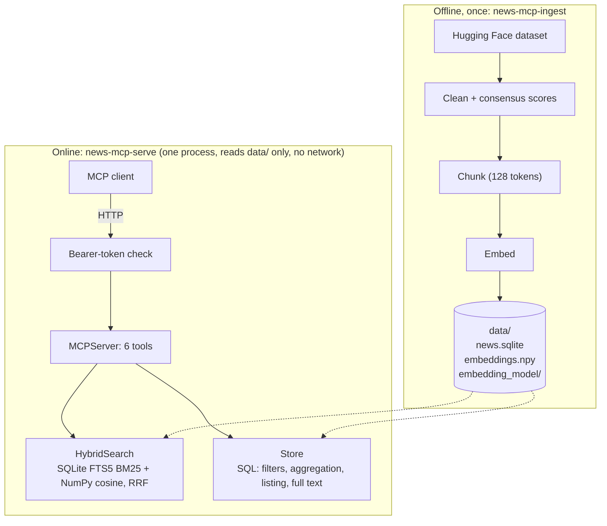

# Nuclear News – MCP server

An MCP server that lets an LLM, working through a standard MCP client, explore 26,483 news
articles about nuclear energy (1998–2025) from 12 Polish, Czech, Slovak and Hungarian outlets.
It provides hybrid search over article passages, SQL aggregation of counts and sentiment,
drill-down to the underlying articles, and token-gated access to full texts. The server returns
evidence and numbers; the client's LLM writes the answer.

Experiments, evaluation method and full benchmarks are in
[`docs/experiments.md`](docs/experiments.md).

## Contents

- [Quickstart](#quickstart)
- [The MCP interface](#the-mcp-interface)
- [Example questions and results](#example-questions-and-results)
- [How it works](#how-it-works)
- [Results](#results)
- [Assumptions and limitations](#assumptions-and-limitations)
- [Future work](#future-work)
- [Use of AI tools](#use-of-ai-tools)

---

## Quickstart

**Requirements:** Python 3.12+ and [uv](https://docs.astral.sh/uv/)
(`curl -LsSf https://astral.sh/uv/install.sh | sh`); plain `pip` also works. About 2.5 GB of disk
and no GPU. Network access is needed only while building the index; the server runs offline.
Intel Macs use a separate pinned dependency stack, defined in `pyproject.toml`.

```bash
uv sync
uv run news-mcp-ingest            # downloads dataset and model, writes data/ (timings in data/manifest.json)
uv run news-mcp-serve             # MCP endpoint: http://127.0.0.1:8000/mcp
```

Without uv (versions pinned in `uv.lock`):

```bash
python3.12 -m venv .venv && source .venv/bin/activate
pip install -r requirements.txt
pip install -e . --no-deps
```

Then drop the `uv run` prefix from the commands.

Every request needs the header `Authorization: Bearer test-token`. To connect Claude Code:

```bash
claude mcp add --transport http v4-news http://127.0.0.1:8000/mcp --header "Authorization: Bearer test-token"
```

Any client that supports Streamable HTTP with a custom header works the same way. For manual
testing, use MCP Inspector (`npx @modelcontextprotocol/inspector`, transport "Streamable HTTP").

| Setting | Environment variable | Default |
|---|---|---|
| Host / port | `NEWS_MCP_HOST`, `NEWS_MCP_PORT` | `127.0.0.1`, `8000` |
| Data folder | `NEWS_MCP_DATA_DIR` | `data` |
| Embedding preset for `news-mcp-ingest` | `NEWS_MCP_EMBEDDING` or `--embedding` | `fast` |
| Token file (see [Authentication](#authentication)) | `NEWS_MCP_TOKENS_FILE` | built-in: only `test-token` |

Other settings (chunk size, number of search candidates) are constants in
[`src/news_mcp/config.py`](src/news_mcp/config.py).

**Tests:** `uv run pytest` runs 37 tests on a nine-article corpus with a fake embedding model, so
no download is needed. They cover cleaning, chunking, search, SQL queries and the HTTP server
(authentication, scopes, readable errors). They pass on the Apple Silicon stack and on the Intel
stack under Rosetta.

---

## The MCP interface

The client gets no extra prompt, so all usage guidance lives in the server's instructions and tool descriptions. Transport is Streamable HTTP, a single endpoint (`POST /mcp`). Wrong arguments return readable errors (e.g. *"Unknown country ['Austria']. Valid values: …"*).

| Tool | Purpose |
|---|---|
| `describe_dataset()` | outlets, counts, date range, data caveats (also resource `news://dataset`) |
| `search_articles(query, filters…, mode="hybrid", limit=10)` | specific facts: best passage per article |
| `search_by_group(query, group_by="country", per_group=3, filters…)` | balanced evidence per country / outlet / language / year |
| `aggregate_articles(group_by, filters…, keywords, sentiment_model, order_by, limit)` | counts, rankings, trends, comparisons |
| `list_articles(filters…, keywords, sort_by, descending, limit, offset)` | the articles behind a number |
| `get_article(article_id)` | full text and all raw ratings; needs the `news:read_full` scope |

The filters shared by all tools are `countries`, `sources`, `languages`, `date_from`, `date_to`
(`YYYY`, `YYYY-MM` or `YYYY-MM-DD`) and `nuclear_related_only`. Every response echoes the filters it applied.

A captured exchange (abridged):

```json
→ {"method": "tools/call", "params": {"name": "search_articles",
     "arguments": {"query": "LNG traded on world markets 2021", "countries": ["Czech Republic"], "limit": 1}}}
← {"structuredContent": {"filters": {"country": ["Czech Republic"]}, "results": [{
     "article_id": "6662", "source": "aktualne.cz", "date": "2022-04-03", "url": "https://zpravy.aktualne.cz/…",
     "chunk_index": 12, "start_char": 4092, "end_char": 4517, "matched_by": ["keyword", "semantic"],
     "passage": "… V roce 2021 se na světových trzích obchodovalo celkem 5400 TWh zkapalněného plynu …"}]}}
```

### Authentication

The MCP SDK checks every HTTP request with `auth.StaticTokenVerifier`:

- a missing or unknown token gets `401`, and nothing else runs;
- a token without the `news:search` scope gets `403` (SDK behaviour; no test covers it, because
the only configured tokens all have this scope);
- `get_article` also requires `news:read_full`.

`test-token` has both scopes. Other tokens can be supplied as JSON via `NEWS_MCP_TOKENS_FILE`, for example a search-only partner token:  
`{"partner-token": {"client_id": "partner", "scopes": ["news:search"]}}`.

---

## Example questions and results

The brief's sample questions, run over MCP with `scripts/sample_questions.py`; raw output in [`results/sample-questions.txt`](results/sample-questions.txt)):

| Question | What the tools returned |
|---|---|
| How much LNG was traded in 2021, according to Czech media? | Rank 1: aktualne.cz, 3 Apr 2022 (article 6662, chunk 12, characters 4092–4517). The passage states that 5,400 TWh of liquefied gas was traded on world markets in 2021. |
| How did sentiment change in Poland, 2010–2020? | 11 yearly groups, 97–570 articles each. The mean is 2.18–2.63 on the 1–5 scale every year, i.e. negative-leaning. Lowest: 2016 (2.18) and 2017 (2.27). The largest year is 2011 (570 articles, 61.8% negative). |
| Compare Slovakia and Hungary in 2022 | Hungary 2.84 (n = 918, 38.6% negative) vs Slovakia 2.50 (n = 514, 56.0% negative). Slovak headlines are more alarmist (3.35 vs 2.95). |
| Which Polish outlets wrote most about nuclear energy in 2020? | Onet_pl 68 · Fakt_pl 16 · Wirtualna Polska 13 nuclear-related articles. |
| Coverage of nuclear weapons in 2023, four countries | 3 relevant passages per country. For example: Russian tactical weapons moved to Belarus (SK), NATO nuclear sharing for Poland (PL), the "Doomsday Clock" (HU), South Korea considering its own weapons (CZ). |

These show that the tools return the evidence and numbers needed. They do not show that an LLM client would choose these calls or answer correctly; that was not tested.

---

## How it works

The design keeps two needs apart

- **Finding evidence:** hybrid search over 128-token chunks, which returns the best passage of each article with its id, outlet, date, URL and character offsets.  
- **Computing numbers:** counts, rankings and sentiment statistics are computed with SQL over every matching article, never estimated from a few search hits.



Code lives in `src/news_mcp/`: `config.py` (all settings), `ingest.py`, `chunking.py`,
`embeddings.py`, `store.py` (SQLite schema and queries), `search.py` (hybrid search and RRF),
`auth.py` and `server.py` (instructions, tools, HTTP app). Evaluation and benchmark scripts are in
`scripts/`, tests in `tests/`.

### Main design decisions

| Decision | Why | Trade-off accepted |
|---|---|---|
| SQLite + FTS5 for articles, chunks, keyword search and analytics | zero install, one file, exact SQL aggregation, built-in BM25 | single writer; fine for a read-only index built offline |
| Exact vector search with NumPy instead of a vector database | 223,653 × 256 vectors; a full semantic search takes a median of 17–36 ms; exact and easy to filter | memory and time grow linearly with the corpus |
| Hybrid search with RRF | keyword is precise for names and numbers; semantic covers other wording and languages; RRF needs no score calibration | loses some rank-1 accuracy on same-language queries |
| Static embedding model by default | build time on a CPU | weaker cross-lingual matching than MiniLM |
| 128-token chunks with a title header | measured best | ~2× more chunks than 256 tokens |
| Numbers from SQL, never from search hits | complete and reproducible counts | topic statistics depend on keywords the client supplies |
| The server returns evidence, the client writes the answer | the brief assigns answer generation to the client; keeps the server deterministic and testable | answer quality depends on the client's LLM |
| Static bearer tokens with scopes | meets the brief; uses the MCP SDK's standard `TokenVerifier` hook | no expiry, rotation or audit log |

### Data preparation

The `train` split of `eoplumbum/v4_nuclear_power_articles` has 26,483 articles from 12 outlets,
dated 1998-07-11 to 2025-01-23. Each article was rated by three LLMs (Gemini 2.0 Flash, GPT-4o,
DeepSeek-V3), and the ratings are used as given. `ingest.clean_article` converts dates to ISO,
changes the language code `cz` to `cs`, re-inserts the space lost between glued sentences at
scraping time (`"rokov.Projekt"` → `"rokov. Projekt"`), and combines the three annotators:

| Field | Rule | Scale |
|---|---|---|
| `nuclear_related` | at least 2 of 3 models gave `article_rating > 0` (0 means "not about nuclear power") | 0/1; 7.6% of articles are 0 |
| `nuclear_sentiment` | mean of the non-zero article ratings; empty if not related | 1 very negative … 5 very positive |
| `headline_sentiment` | mean of the three ratings | 1 pessimistic … 5 optimistic |
| `headline_alarmism` | `6 − mean(raw)`, because in the raw data 5 means *not* alarmist | 1 calm … 5 alarmist |

All nine raw ratings are kept and returned by `get_article`. Data properties to be aware of:
annotators disagree noticeably (Pearson correlation of the article rating between models is
0.52–0.69); coverage is uneven (432 articles for Fakt_pl to 5,207 for sme.sk); 258 titles are
duplicates; some Slovak texts lost diacritics at scraping time; source bodies are cut at 32,767
characters.

### Retrieval

`HybridSearch.search` runs both retrievers inside the same metadata filters:

1. **Keyword:** BM25 over chunks (SQLite FTS5, accents folded, title weighted 2×). Words of 4+

   letters match as prefixes, to cope with word endings.
2. **Semantic:** cosine similarity between the query vector and every chunk vector.

Each returns its best 200 chunks. They are merged with Reciprocal Rank Fusion (each chunk scores
`Σ 1/(60 + rank)` over the retrievers that found it; Cormack, Clarke & Büttcher, 2009), then only
the best chunk per article is kept. Each result carries the article metadata and URL, the passage
with its `start_char` / `end_char` offsets, and `matched_by` (which retrievers found it).

Chunks are made with LangChain's `RecursiveCharacterTextSplitter`, sized in tokens of the embedding
model's tokenizer (128 tokens, 16 overlap), and each is embedded with its article title as a header.
The default embedding model is the static `static-similarity-mrl-multilingual-v1` (`fast` preset),
chosen because it builds the whole index in minutes on a CPU. `--embedding crosslingual` selects a
MiniLM transformer, which matches English questions to non-English articles better but builds far
slower. The reasoning and numbers are in [`docs/experiments.md`](docs/experiments.md).

### Analytics

`aggregate_articles` runs one SQL `GROUP BY` over all matching articles. Per group it returns
`article_count` and `sentiment_rated_count`, the mean nuclear sentiment, the shares positive (≥ 3.5)
and negative (≤ 2.5), headline means, and three `example_article_ids` (the least neutral articles of
the group). `sentiment_model` switches from the consensus to a single annotator, to check
robustness. `keywords` restricts the statistics to articles containing given terms. Defining a topic
that way is transparent, but depends on the client supplying terms in all four languages.

---

## Results

**Retrieval quality** of the default index, from a known-item benchmark (each query is built for one
target article; top-1 / top-10 is how often that article ranks first / in the top 10):

| Query set | Keyword | Semantic | **Hybrid** (default) |
|---|---|---|---|
| headline (n = 200) | 98.0% / 100% | 91.0% / 96.5% | **97.0% / 100%** |
| partial sentence (n = 200) | 93.5% / 99.0% | 62.0% / 83.0% | **80.5% / 97.5%** |
| English → native (n = 16) | 0% / 6.3% | 31.3% / 50.0% | **6.3% / 50.0%** |

- Same-language search finds the target in the top 10 for 97.5% of partial-sentence queries in
hybrid mode, but rank 1 is less reliable than with keyword search alone.
- English questions about non-English articles find their article in the top 10 about half the time
(16 queries, indicative only).
- Known-item search is a proxy that favours keyword search, and none of it measures LLM tool choice
or answer quality. Results are identical on the Intel Mac and the M3.

**Performance** (full detail in [`docs/experiments.md`](docs/experiments.md#5-performance)):

| | Intel Mac (i9-9880H, 16 GB) | Apple M3 Max |
|---|---|---|
| Full build (chunking + embedding) | ≈ 4.2 min | ≈ 1.7 min |
| Hybrid search, median | 48.7 ms | 21.8 ms |
| `aggregate_articles`, country × year | 1.2 s | 0.6 s |

On the Intel Mac, 89% of the build is chunking; embedding takes under 30 s with the default model,
whereas a transformer model would take about 1.5 h.

---

## Assumptions and limitations

**Assumptions** (if wrong, the effect is in brackets):

- The dataset is the `train` split (26,483 articles) (change `DATASET_SPLIT` in `config.py`).
- "Sentiment towards nuclear energy" means the article rating, not headline tone (the tools return both).
- The three annotators count equally and a majority decides relevance (`sentiment_model` exposes each one).
- Positive ≥ 3.5, negative ≤ 2.5 on the consensus scale (the shares would shift).
- Sub-topics (e.g. nuclear weapons) are defined by client-supplied keywords (needs topic labels).
- Dates are publication dates; the 2021 LNG figure is in an April 2022 article (the client decides how strictly to filter).
- Texts stay in their original language and the client's LLM reads them.
- "Policy" means scopes attached to a bearer token; deployment is local, single-user, no TLS.
- Known-item queries are a usable stand-in for real questions when choosing chunking and model.

**Limitations:**

- Static embeddings ignore word order and context; cross-lingual retrieval with the default model is weak.
- Hybrid search loses some rank-1 accuracy against keyword search.
- Keyword-defined topics depend on the client's keywords.
- An exact vector scan grows linearly with corpus size.
- Static tokens have no expiry or rotation.
- Hybrid-search latency on the Intel Mac has a tail (p95 319 ms against a 48.7 ms median); the cause
was not investigated.
- Aggregation is slowish (about 1.2 s for 100 country × year groups on the Intel Mac), because
example ids are fetched with one small query per group.
- No confidence intervals on the statistics, and the 258 duplicate titles are counted separately.

---

## Future work

In priority order; none of this is implemented.

1. **A labelled question set and an LLM client in the loop.** About 50 real questions (needle, trend,

   comparison, ranking, summary, cross-lingual) with gold articles and expected answers, run through
       real Claude and GPT clients, measuring recall@k, tool choice and answer accuracy. Everything
       below needs this to be judged.
2. **Re-rank the top results** with a small multilingual cross-encoder over the top ~30 chunks, to

   fix the rank-1 loss of hybrid search. Added CPU latency must be measured on the Intel Mac.
3. **Better cross-lingual retrieval with a fast build:** make `crosslingual` the default where a GPU

   is present, translate queries with a small local model, fine-tune the static table on pairs from
       this corpus, or distil a table from MiniLM. Needs a larger English → native set (~200 questions).
4. **Topics as data:** assign each article to a fixed topic set offline (weapons, accidents, new

   builds, prices, waste, policy) so topic statistics no longer depend on keywords.
5. **Faster builds and uncertainty:** count tokens once per sentence during chunking, ONNX or int8

   quantisation for transformer models, an embedding cache, bootstrap confidence intervals, and
       de-duplication of syndicated articles.
6. **Production concerns:** OAuth / JWT tokens from an identity provider, per-licence policies, TLS,

   rate limits and a container image. Deliberately out of scope for a local deliverable.

Considered and rejected for now: an approximate vector index (FAISS, HNSW), because exact search
over 223,653 vectors takes a median of 17–36 ms.

---

## Use of AI tools

Claude Sonnet 5.5 was used as a development assistant for:

- writing the tests and the evaluation and benchmark scripts;
- advising on the design and implementation of the MCP server and the data store;
- reviewing the code and suggesting improvements;
- drafting this README.
